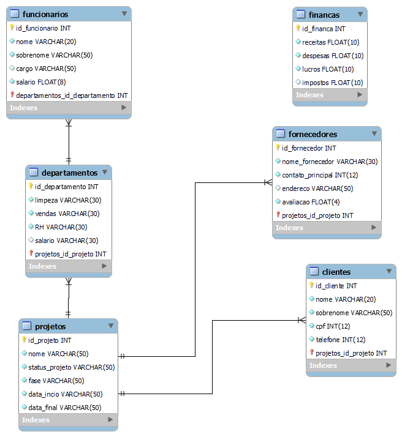

# 🗄️ Modelagem de Base de Dados: Sistema ERP Corporativo

  

  

---

> **Projeto de modelagem de dados (Diagrama de Entidade-Relacionamento) desenvolvido no MySQL Workbench. O objetivo é arquitetar a base de dados relacional para um sistema ERP (Enterprise Resource Planning), capaz de gerir o fluxo de trabalho integrado de uma empresa ou indústria.**

---

## 🗺️ Diagrama de Entidade-Relacionamento (DER)

Abaixo encontra-se a arquitetura visual do esquema da base de dados, demonstrando as tabelas, as tipagens de dados (VARCHAR, INT, FLOAT) e as chaves estrangeiras (Foreign Keys) que garantem a integridade relacional do sistema.

---

## 🧩 Estrutura e Lógica de Negócio

O esquema foi normalizado e dividido em módulos essenciais para o funcionamento corporativo:

* 👥 **Gestão de Recursos Humanos:** A tabela `funcionarios` regista os colaboradores e está diretamente associada (1:N) à tabela `departamentos`, permitindo o mapeamento exato da alocação de pessoal.

* 🏭 **Controlo de Operações e Projetos:** A tabela `projetos` atua como o núcleo operacional da cadeia de valor, cruzando dados de `departamentos` responsáveis, `clientes` (destinatários) e `fornecedores` (parceiros da cadeia de suprimentos).

* 💰 **Módulo Financeiro:** A tabela `financas` gere o fluxo de caixa macro da empresa, mapeando receitas, despesas, impostos e lucros apurados.

---

## 🛠️ Ferramentas Utilizadas

* **MySQL Workbench:** Para o design estrutural, engenharia reversa/direta e exportação do modelo físico.

* **Paradigma Relacional:** Foco na normalização de dados e integridade referencial.
